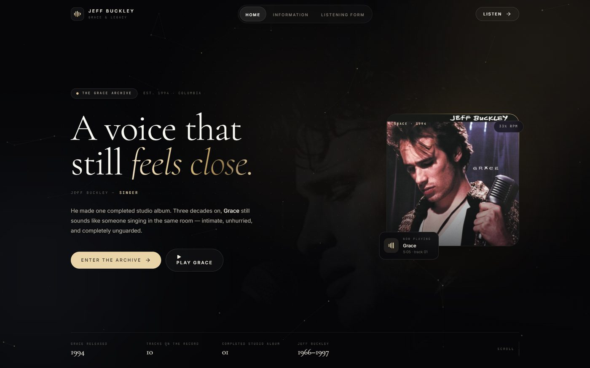

# Jeff Buckley — Grace & Legacy

An immersive, editorial redesign of the three-page Jeff Buckley site, built with
**React 19 + Vite + Tailwind CSS v4 + Framer Motion**. Dark "Nocturne" palette,
bronze light, Cormorant Garamond display type, cursor-aware cards, a canvas
particle field, a lightbox gallery, and a working custom audio player.



---

## Quick start

Requires **Node 20.19+** (Vite 8).

```bash
npm install
npm run dev        # http://localhost:5173
npm run build      # outputs to dist/
npm run preview    # serve the production build
```

The site uses **hash routing** (`#/information`), so the built `dist/` folder can
be dropped on GitHub Pages, Netlify, or any static host without rewrite rules.

---

## What changed

| | Before | After |
|---|---|---|
| Theme | Flat dark greys, inline styles | Obsidian surfaces, bronze gradients, glass panels, film grain |
| Type | Two families, one weight | Cormorant Garamond display / Inter body / JetBrains Mono labels |
| Hero | Static text + image | Video-capable background, split-text headline, particles, dot grid, tilting album card |
| Cards | Plain boxes | Spotlight-tracking hover glow, border beam, bento layout |
| Media | Bare `<audio>` / `<video>` | Custom player with waveform seeking, video lightbox, masonry gallery |
| Motion | None | Scroll reveals, staggered text, parallax, marquee, page-level micro-interactions |
| Form | Unstyled native controls | Custom radios/checkboxes, inline validation, animated success summary |

Every piece of copy and every assignment requirement from the original site is
still present — see [Assignment coverage](#assignment-coverage).

---

## Folder structure

```
jeff-buckley-site/
├─ index.html                  # fonts, meta, #root
├─ vite.config.js              # base: "./" + Tailwind v4 plugin
├─ package.json
├─ public/
│  ├─ favicon.svg
│  ├─ images/                  # your images live here (see below)
│  ├─ audio/                   # drop your MP3s here
│  └─ video/                   # drop your MP4s here
├─ docs/
│  ├─ react-bits.md            # how to install/replace React Bits components
│  └─ screenshots/
├─ tools/
│  └─ generate_placeholders.py # regenerates the abstract placeholder art
└─ src/
   ├─ main.jsx                 # HashRouter + StrictMode
   ├─ App.jsx                  # routes + listening context
   ├─ index.css                # design tokens, utilities, effects
   ├─ data/
   │  ├─ site.js               # all copy: nav, features, songs, quote
   │  └─ media.js              # ← the only file you edit to swap media
   ├─ lib/utils.js             # cn(), time formatting, waveform seeding
   ├─ context/
   │  └─ ListeningProvider.jsx # lets any "play" button drive the player
   ├─ hooks/
   │  ├─ usePageMeta.js        # per-route <title> / description
   │  └─ useSectionNav.js      # in-page + cross-page section scrolling
   ├─ components/
   │  ├─ layout/
   │  │  ├─ Layout.jsx         # shell, scroll restore, grain overlay
   │  │  ├─ Navbar.jsx         # glass nav, active pill, mobile menu
   │  │  ├─ ScrollProgress.jsx # top reading-progress bar
   │  │  └─ Footer.jsx         # closing statement, link columns, wordmark
   │  ├─ sections/
   │  │  ├─ Hero.jsx           # rays, meteors, aurora text, shimmer CTA, beam card
   │  │  ├─ SongMarquee.jsx    # running track-title ribbon
   │  │  ├─ Story.jsx          # album sleeve + parallax still + narrative
   │  │  ├─ SignalPath.jsx     # NEW: animated beams + orbiting tracks + counters
   │  │  ├─ FeatureGrid.jsx    # React Bits spotlight cards + Magic border beam
   │  │  ├─ MediaShowcase.jsx  # video cards + masonry gallery + lightbox
   │  │  ├─ ListeningRoom.jsx  # custom audio player + tracklist
   │  │  ├─ QuoteBand.jsx      # ivory band + sparkle text lyric
   │  │  ├─ SongTable.jsx      # the assignment table, restyled + playable
   │  │  └─ CTA.jsx            # retro grid + meteors + vinyl + shimmer CTA
   │  ├─ magicui/              # vendored Magic UI source (12 components)
   │  │  ├─ aurora-text.tsx    ├─ meteors.tsx      ├─ border-beam.tsx
   │  │  ├─ shimmer-button.tsx ├─ animated-shiny-text.tsx ├─ dot-pattern.tsx
   │  │  ├─ retro-grid.tsx     ├─ animated-beam.tsx ├─ orbiting-circles.tsx
   │  │  └─ number-ticker.tsx  ├─ sparkles-text.tsx └─ light-rays.tsx
   │  ├─ reactbits/            # vendored React Bits source (5 components)
   │  │  ├─ SpotlightCard.jsx  ├─ StarBorder.jsx   ├─ Magnet.jsx
   │  │  └─ BlurText.jsx       └─ ClickSpark.jsx
   │  └─ ui/
   │     ├─ SplitText.jsx      # per-character reveal
   │     ├─ RotatingText.jsx   # 3D flip word cycler
   │     ├─ Reveal.jsx         # scroll-triggered fade/rise
   │     ├─ BorderBeam.jsx     # travelling light (Story)
   │     ├─ TiltCard.jsx       # 3D pointer tilt + glare
   │     ├─ Particles.jsx      # canvas dust + constellation links
   │     ├─ DotGrid.jsx        # dot field with cursor spotlight
   │     ├─ Marquee.jsx        # seamless ticker
   │     ├─ Lightbox.jsx       # image/video modal, keyboard + focus handled
   │     ├─ Button.jsx         # primary/ghost/outline/dark variants
   │     └─ SectionHeading.jsx # eyebrow + display title + action
   └─ pages/
      ├─ Home.jsx
      ├─ Information.jsx       # article, notes sidebar, table, player, gallery
      └─ ListeningForm.jsx     # validated form + success state
```

---

## Where your media goes

All paths are centralised in **`src/data/media.js`**. Drop files into `public/`
using these names (or edit the paths once), and they appear everywhere.

| Asset | Path | Used by |
|---|---|---|
| Album sleeve | `public/images/grace-cover.jpg` | Hero card, story, player thumbnail, gallery |
| Video still | `public/images/lover-still.jpg` | Hero poster, featured video card, gallery |
| Hero loop | `public/video/hero-loop.mp4` | Hero background (poster remains if missing) |
| Featured video | `public/video/lover-official.mp4` | Video card → lightbox |
| Second video | `public/video/grace-official.mp4` | Grace official video card → lightbox |
| Tracks | `public/audio/*.mp3` | Listening room (5 files) |
| Gallery art | `public/images/placeholder-0*.jpg` | Masonry gallery — replace one-for-one |

Notes:

- The archive you sent did not include the `audio/` or `video/` files, so those
  are placeholder paths. The player detects a missing file and shows
  *“Add Grace.mp3 to public/audio”* instead of breaking.
- `lover-still.jpg` was cropped from your AVIF still to remove the player's white
  corner artifacts and the Vevo watermark strip. Swap it for a cleaner still if
  you have one.
- Video poster fallbacks mean the page still looks finished before any MP4 exists.
- Four gallery images are procedural art generated by
  `tools/generate_placeholders.py` — safe to delete once you add your own.

---

## Design system

Everything is CSS-first via Tailwind v4 `@theme` in `src/index.css` — there is no
`tailwind.config.js`.

**Colour**

| Token | Hex | Role |
|---|---|---|
| `ink-950 … ink-600` | `#060608 → #23232c` | Surfaces, borders, depth |
| `ivory-50 / 100` | `#fbf9f4 / #f2ede2` | Headlines, inverted quote band |
| `mist-200 … 500` | `#d8d3c8 → #6b665e` | Body copy, secondary labels |
| `bronze-200 … 600` | `#f6e9cd → #a5874e` | Accent, gradients, focus |
| `steel-300 … 500` | `#b8c3d2 → #65748b` | Secondary glow in gradients |

**Type** — `font-display` Cormorant Garamond, `font-sans` Inter, `font-mono`
JetBrains Mono. Headline sizes use `clamp()` so they scale without breakpoints.

**Custom utilities** — `.glass`, `.grain`, `.text-bronze-gradient`, `.dot-grid`,
`.border-beam`, `.mask-fade-x`, `.option-mark` (form controls), `.seek` (range
input).

**Motion** — Framer Motion springs/easing `[0.22, 1, 0.36, 1]`. Every component
checks `useReducedMotion()`, and `index.css` neutralises CSS animation for
`prefers-reduced-motion`.

---

## Magic UI + React Bits

The second design pass vendors **official component source** into the repo:

- `src/components/magicui/` — 12 Magic UI components: `AuroraText`, `Meteors`,
  `BorderBeam`, `ShimmerButton`, `AnimatedShinyText`, `DotPattern`, `RetroGrid`,
  `AnimatedBeam`, `OrbitingCircles`, `NumberTicker`, `SparklesText`, `LightRays`.
- `src/components/reactbits/` — 5 React Bits components: `SpotlightCard`,
  `StarBorder`, `Magnet`, `BlurText`, `ClickSpark`.

Where they appear:

| Component | Placement |
|---|---|
| `LightRays`, `Meteors`, `AuroraText` | Hero lighting, particles and accent line |
| `SplitText`, `BlurText` | Hero headline and standfirst |
| `ShimmerButton`, `Magnet`, `StarBorder` | Hero + CTA actions |
| `BorderBeam` (Magic) | Album card, featured feature card |
| `SpotlightCard` (React Bits) | Feature grid |
| `AnimatedBeam`, `OrbitingCircles`, `NumberTicker` | New `SignalPath` section |
| `AnimatedShinyText` | Section eyebrows |
| `DotPattern` | Signal path + footer backgrounds |
| `RetroGrid`, `Meteors` | CTA panel |
| `SparklesText` | Lyric quote |
| `ClickSpark` | Global click feedback |

Adaptations worth knowing:

- **No new dependencies.** `motion/react` is aliased to the already-installed
  `framer-motion` in `vite.config.js`, and `@` is aliased to `src` for their
  `@/lib/utils` imports. GSAP/Three-based components were deliberately skipped.
- **TypeScript sources in a JS app.** Magic UI ships `.tsx`; Vite compiles them
  without a type-check step, so the rest of the app stays JSX.
- **`@theme inline` is required** for Magic UI's animation tokens. They read
  per-element variables (`--duration`, `--speed`, `--angle`); a normal `@theme`
  resolves those at `:root`, where they are undefined, and the animation silently
  never runs. See the block in `src/index.css`.
- **Palette overrides.** The libraries default to purple; the vendored copies and
  props are tuned to bronze, ivory and steel. Some defaults were edited in place
  (`meteors.tsx`, `animated-shiny-text.tsx`, `number-ticker.tsx`).
- **Reduced motion.** Decorative layers are `motion-reduce:hidden`; components
  that already check `prefers-reduced-motion` keep doing so.

Full install/swap instructions (CLI variants, prop differences, licensing) are in
**[docs/react-bits.md](docs/react-bits.md)**.

---
## Assignment coverage

The original brief (semantic HTML, a 3+ column / 4+ row table, audio, video, and
all form control types) is fully preserved in the React build:

- **Semantic HTML** — `header`, `nav`, `main`, `section`, `article`, `aside`,
  `figure`, `figcaption`, `fieldset`, `legend`, `table`, `footer`.
- **Table** — `SongTable.jsx`: 5 rows × 4 content columns (song, album, focus,
  listen) plus an index column.
- **Audio** — `ListeningRoom.jsx`, five tracks with a custom transport.
- **Video** — `MediaShowcase.jsx` + `Lightbox.jsx`, poster fallbacks.
- **Form** — `ListeningForm.jsx`: text, email, password, number, date, radio,
  checkbox group, select, textarea, submit and reset, plus client-side
  validation and a success summary.

The original three HTML/CSS files are kept untouched in the separate
`legacy-site/` folder (next to this project, outside the repo) for submission or
comparison. Because this redesign is React + Tailwind, the "three CSS methods"
requirement (inline / embedded / external) no longer applies to the new build —
the legacy folder is the artefact that demonstrates it.

---

## Accessibility & performance

- Keyboard: lightbox supports `Esc` / `←` / `→`, focus moves to the close button,
  body scroll locks; the mobile menu closes on `Esc`; all controls are real
  buttons with labels.
- Screen readers: split text keeps an `aria-label`; decorative layers are
  `aria-hidden`; gallery buttons announce the image caption.
- Contrast: body copy is `mist-300` on near-black (≥ 7:1), labels are the smallest
  intentional pair (mono 8–10px) and never carry essential information alone.
- Performance: images are lazy-loaded and sized, the particle canvas caps DPR at
  2 and pauses off-screen/hidden, and animation is disabled for reduced motion.
  Build output is ~17 kB CSS and ~182 kB JS gzipped.

---

## Deploying to GitHub Pages

The repo ships `.github/workflows/deploy.yml`, which builds the site and
publishes `dist/` on every push to `main`.

1. Push the project to a GitHub repository.
2. Open **Settings → Pages → Build and deployment**, and set **Source** to
   **GitHub Actions** (not "Deploy from a branch" — that would serve the Vite
   source `index.html` and show a blank page).
3. Push to `main`, or run the workflow manually from the **Actions** tab.

The site is then at `https://<username>.github.io/<repo>/`.

Why this works without path fixes:

- `base: "./"` in `vite.config.js` makes every asset URL relative.
- `HashRouter` means deep links look like `#/information`, so no server
  rewrites are needed.
- The workflow writes `dist/.nojekyll` so GitHub does not strip `_`-prefixed
  files.

Manual alternative: run `npm run build` and publish the contents of `dist/` to a
`gh-pages` branch, then point Pages at that branch.

For a different host that serves `index.html` for every path, swap
`HashRouter` for `BrowserRouter` in `src/main.jsx`.

---

## Credits

Design and build: React 19, Vite 8, Tailwind CSS 4, Framer Motion, Lucide.
Typefaces: Cormorant Garamond, Inter, JetBrains Mono (Google Fonts).
Educational project — not affiliated with the Jeff Buckley estate.
